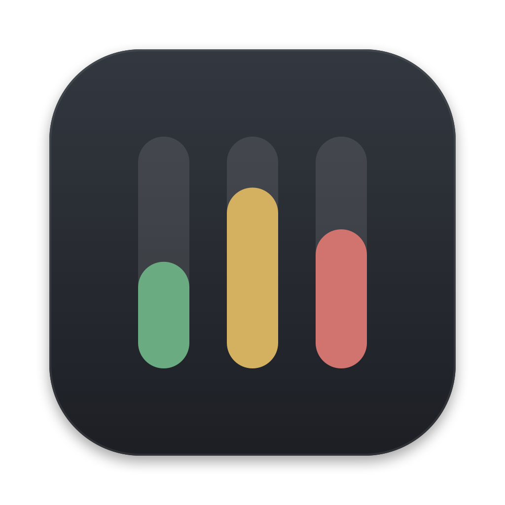

<p align="center">
  
</p>

<h1 align="center">Sysbar</h1>

<p align="center">
  <a href="https://github.com/Atanur/sysbar/releases"></a>
  <a href="https://github.com/Atanur/sysbar/releases/latest"></a>
  
  <a href="LICENSE"></a>
  <a href="https://github.com/Atanur/sysbar/stargazers"></a>
</p>

<p align="center">
  A tiny, native system monitor for the Mac's menu bar and notch.<br>
  <a href="https://sysbar.atanur.dev">sysbar.atanur.dev</a><br>
  CPU, GPU, memory, power, disk and network, always in sight — and your servers over SSH when you need them.<br>
  <a href="CHANGELOG.md">What's new</a>
</p>

---

## Why Sysbar

- **Glanceable.** Each metric is a thin level bar and a fixed-width number, so the menu bar never shifts as values change. Bars can be tinted by load or follow the menu bar's own colour.
- **Light.** Written in Swift against the system's own counters. At rest, in the menu bar or beside the notch, it uses under 1% of a single core and about 20 MB of memory; once the panel has been opened it settles at around 35 MB. It stops sampling while the Mac or its screens sleep.
- **Honest.** It shows what can be measured and hides what cannot. Values that are estimates are labelled as such.
- **Private.** No accounts, no analytics. Besides the SSH connections you set up, the only request is a once-a-day check for a new release on GitHub, which you can turn off; nothing about your Mac is sent.

## Features

**Menu bar**
- Choose any of CPU, GPU, memory, power, disk and network, and drag them into the order you like.
- Fixed-width slots: no jitter between `3%` and `100%`.
- Optional load colours (neutral → amber → red), adapted for light and dark menu bars.
- Three styles: bars and values, bars only (the smallest), or values only. The bars glide to a new level, and on start the logo's bars wave until the first reading arrives.
- On battery, the charge can join the menu bar once it drops to a level you choose (always, 80%, 50% or 20%), staying neutral until it turns amber and red.
- **Or around the notch** (Settings › General › Location): Sysbar leaves the menu bar and lives at the top of the screen. The island is black by default and continues the notch. Its two ears hold items you choose (see below). By default the left ear shows the Sysbar readings (up to three, the battery among them when it is shown) and the right ear an icon for each feature: Stash (once it is on) and Clipboard (once its history is on, with or without the stash). While the heat is out of the ordinary a heat-warning glyph (in the warning's colour) shows first in the right ear, and while keep awake is on a keep-awake glyph does; click one, or rest the pointer on it, to open the island on System with the fan or keep-awake panel already unfolded. Click an item, or rest the pointer on it, to open the panel on that tab, and click it again to close the panel. The panel is a popup that hangs from the strip of ears and notch, a quarter narrower than the full-width sheet it used to be, and the strip never moves: the panel is drawn down from under it like a sheet (at once with Reduce Motion), and strip and panel are one continuous black shape, the strip's lower corners flowing into the panel's top edge with concave curves. The items stay in the strip, level with the notch, as its tabs: the readings are System, the icons are Stash and Clipboard, and the selected one is highlighted. Settings is the gear at the right end of the panel's first row, which also has the machine tabs and, on System, the fan and keep-awake buttons just left of the gear (the fan button only on a Mac that reads its temperatures; each can be hidden in Settings › Features), or the tab's name. Each page has the height of its own content: the panel grows or shrinks, on the same sheet curve that opens it, when you change tab or unfold a panel, and a Stash or Clipboard list is as tall as its items up to about 420 pt (less on a short screen) and scrolls beyond that. The fan and keep-awake buttons unfold their panel under the first row, pushing the cards down; only one is open at a time, and pressing the button again folds it. Click the readings, or rest the pointer on them, and the panel opens on System; rest it elsewhere on the island and it opens on the tab shown last; move away and it closes, or click to keep it open until you click anywhere outside it, with any mouse button, or press Escape. Right-click for Settings and Quit. The notch is measured from the display each time, so it fits every model and scaling. On a display without one (an external display, a Mac without a notch, or with the lid closed) it is a small glass capsule in the middle of the menu bar that opens into a card growing beneath it, joined to it in the same way.

- **Customise the island** (Settings › Notch, with a preview at the top). *Displays*: built-in display only (the default; a Mac with no built-in display uses its primary one), all displays (each has its own island, notch-shaped where there is a notch and a capsule elsewhere; opening one leaves the others closed, and the stash picker opens on the display under the pointer), or the display with the active menu bar, which follows the focus. Displays being connected, removed, rearranged or rescaled are followed as they happen, and the island is not in the way in full screen: while a full-screen app (a video, a game) is on a display, that display's island is hidden, and moving the pointer onto the notch (or to the very top of the screen above it) brings it back until the pointer leaves it again; dragging files there brings it back to be dropped on too. Full screen is told from the display's Space, or a window of another app covering the whole display, and it is judged for each display on its own. *Background*: automatic (black around the notch, glass on a display without one; the default), black, or glass. Black always uses the dark look; glass follows the system's light or dark look. *Left of the notch* and *Right of the notch*: you decide what goes in each ear. The items are System (the readings, as one), Stash and Clipboard; each can be in either ear, in the order you like (drag a row to reorder it or move it to the other side, or use the row's menu: Move up, Move down, Move to the other side). Each item is shown *Always*, or *Only when open*: then it is not on the closed island and appears in its place, fading in with the panel, when the island opens, so it is still a tab. Nothing can be hidden for good, because the ears are the open panel's only tabs; to remove a feature, turn it off on its own page (an item whose feature is off is dimmed and says why). An ear is never wider than the room beside the notch: when its items do not fit, the ones farthest from the notch are left out, and the readings give way first. The defaults are System on the left, the two icons on the right. A layout saved by an earlier version loses its Fans and Keep awake items, which are buttons of the System page now. The preview shows the island closed or open. *System readouts*: how many readings the System item shows (none to four, as many as fit beside the notch with the other items in its ear); which ones, the battery included, and in what order, are set in Settings › Readouts for the menu bar and the notch alike. With none, the System tab is an icon once the island opens. With both ears empty the closed island is just the notch, or a small capsule. *Icons*: coloured or monochrome (the heat-warning glyph keeps its colour), and small, medium or large (large is limited to the menu bar's height on a display without a notch). *Open on*: hover (the default) or click only. *Show the island*: always (the default), or only while the pointer is on it, for when you want the top of the screen clear; in full screen it is hidden until the pointer reaches it whichever you choose. A hidden island draws nothing and takes no clicks.

**Popover**
- One card per metric with a graph of the last 150 samples, so its span follows the refresh rate (15 seconds at 0.1 s, 5 minutes at 2 s). Cards can be reordered and laid out automatically (two columns for an even count, one for an odd), in one column, or in two.
- The cards are black, white and grey. Colour appears only where it means something: a graph turns amber, orange and red as its load rises, and the charge going into the battery is green. On the adapter a bolt sits beside the percentage: green while it charges, plain once the battery is full or macOS holds the charge, and always plain on a Mac without a battery.
- Disk, Network and Power draw two lines either side of a zero line on one scale: read and write, download and upload, and what the Mac uses and what goes into the battery while it charges. The Disk card's corner shows the room left (amber under 15 %, red under 5 %), the Network card's shows Wi-Fi or Ethernet.
- Click a card to open the matching tab in Activity Monitor (or Battery settings). Right-click the menu bar item for Settings, Check for updates, About and Quit.
- Power reacts to how the Mac is powered: charge and time left on battery; on the adapter, the bolt in the corner and the adapter and wall draw in its tooltip.
- **Top apps** table with CPU, memory, GPU, network and estimated energy per app; helper processes fold into their app. CPU is a share of the whole Mac, like the CPU card, so the rows never add up to more than the total (one decimal under 10%). Columns are configurable.

**Temperature and fans**
- The fan button, left of the settings gear on the System page, unfolds a panel that names what is warming the Mac: processor work, graphics work (language models, rendering, games), heavy work, cooling down, warm at rest, cooling at its limit, or macOS slowing down to cool. It shows CPU, GPU, memory and battery temperatures, each the mean of the hotter half of that part's sensors.
- A thermometer appears in the menu bar only when the heat is out of the ordinary; a busy chip in the 80s is not. Settings › Features › Temperature and fans has a **Heat warning** choice: Off, Early (about 10° sooner), Default, or Late (about 5° later). macOS slowing the Mac down and cooling that cannot keep up count at every setting except Off.
- The fan button's icon is drawn still: an outline while macOS runs the fans, amber, orange and red as they work harder, dimmed when they stand still, and filled while you set them by hand.
- Fans: Automatic, or Manual with one slider from each fan's minimum to its maximum speed. Manual control uses a small helper that macOS asks you to approve once. It can only set fan speeds and keep the Mac awake (below), accepts only Sysbar signed by the same developer, and returns the fans to automatic when Sysbar quits, crashes or hangs (a 15-second lease), or when the Mac sleeps.

**Keep awake with the lid closed** (laptops)
- The keep-awake button on the System page (a laptop, or a cup on a Mac without a lid) keeps the Mac awake with its lid closed. A pop-up menu turns it off, or on for how long: 1 hour, 4 hours, until a time you set (today, or tomorrow if it has passed), until you turn it off, while the charger is connected, or for as long as an app you pick from the open ones stays open. It sets `pmset disablesleep` through the same helper, so there is no password prompt.
- It ends by itself when its time is up, when the charger is unplugged (for "while charging"), or when the battery falls to 20 % while unplugged (10, 20 or 30 % in Settings; never off, because a closed Mac in a bag is the risk), and the panel says why. It also ends when Sysbar quits, crashes or hangs (the same 15-second lease). If it is switched off elsewhere (`pmset disablesleep 0`), Sysbar notices within seconds.
- A setting you turned on yourself in Terminal is shown as on, and is only turned off if you choose Off.
- **Move the mouse when idle** keeps chat apps from showing "away": while keep awake is on and nobody has touched the Mac for a while (a minute by default; 30 seconds, 1, 2 or 5 minutes, or off, in Settings › Keep awake), the cursor takes a curved trip to the middle of the screen (or to the lower right, if it already is near the middle) and back, and again after the same wait for as long as nobody touches the Mac. Nothing is clicked or typed, it waits while a button is held or the screen is locked or off, and it needs the Accessibility permission, which Sysbar asks for only when you turn this on. Using it to misrepresent your working hours, or against a workplace policy, is between you and your employer.
- A closed Mac in a bag can get warm; that is why it is never permanent.
- On a Mac without a lid (a Mac mini, Studio or iMac) the same menu keeps it from going to sleep while idle, with the same choices except "while charging". It needs no helper.

**Stash** (off until you turn it on in Settings › Features, where it is turned on and off like the Fans and Keep awake buttons)
- Named stashes that hold files and copied text until you delete them, such as Work, School or Project. There is always a Main stash, which cannot be deleted or renamed; add as many others as you like. Each has its own colour from a fixed palette, so they can be told apart at a glance as well as by name. With the stash on, the Sysbar panel has a Stash tab after System, Fans and Keep awake. The Stash tab has a tab bar along the top with one tab per stash, showing its colour, name and number of items (it scrolls sideways when there are many) and a New Stash tab at its end; choose a tab to see that stash's items below it, and drop files on a tab to add them to that stash. New Stash makes one with the next free name (Stash 2, Stash 3 …) and lets you type its name at once. Double-click a stash or use its menu to rename it (two stashes cannot share a name), to change its colour or to delete it. Deleting one that holds items asks first, and its items move to Main (or, if you choose so in Settings, are deleted with it; the files themselves are never touched). Under the notch the panel opens wide.
- Files are remembered by bookmark, not copied, so a file you move or rename in Finder is still found; one that is gone is marked File not found. Each item can be dragged out (it stays in the stash), opened, previewed with Quick Look, shown in Finder, moved to another stash from its Move to menu, or removed. Text and links go in a stash too, from the clipboard; a link opens and text is copied back with a double-click. Files dropped on the Stash tab go to the stash that is selected, and a file dropped on another stash's name goes there. Stashes are saved in `~/Library/Application Support/Sysbar/Stashes`, in a folder only your account can read; turning the stash off or resetting Settings does not delete them. Settings › Stash › Storage can keep them in another folder (a folder called Stashes is made inside the one you choose): Choose… moves the file there after asking, Reset to Default moves it back, and Show in Finder shows it. A folder that already holds stashes can be used instead, and then the old file is left where it was.
- Stashes live in the island (or the menu bar popover), not in windows of their own: nothing appears elsewhere on the screen. Dragging files over the island at the top of the screen opens it downward into the stash picker, one coloured tile per stash plus New Stash; drop on a tile to put the files there. Shaking the pointer during the drag, or holding a modifier key (⇧ by default), opens the same picker in the island, or the Stash tab of the popover when Sysbar is in the menu bar. Dropping on New Stash makes a stash with the next free name, adds the files and brings up the Stash tab so you can name it. Shelves put away before stashes had names are carried over to Main once, when their files still exist.
- Global shortcuts you record yourself: New Stash (makes one and brings up the tab with its name ready to type) and Add Clipboard to Stash (copied files, or copied text, go to the stash that last took something, or Main, or the stash you name in Settings). It reads the clipboard itself, so it works with the clipboard history off.
- Choose how sensitive the shake is, which key opens the picker, whether dragging over the island opens it, and which apps never bring it up. Shaking and the modifier key read mouse events only, so the stash needs no permission.

**Clipboard history** (off until you turn it on in Settings › Features › Clipboard; a feature of its own, which works with the stash on or off)
- Keeps what you copy: text, links, rich text, images and files, newest first. With it on, the Sysbar panel has a Clipboard tab (and the island an icon) where you can search the copies, filter them by kind (text, links, images or files) and clear them; a global shortcut you record opens a panel beside the pointer where you type to search, press ⌘1 to ⌘5 to filter by kind, choose with the arrow keys and press Return to put an item back on the clipboard, ready to paste with ⌘V. With the stash on, copied files, text and links can go from the history to any stash, chosen from the item's Add to Stash menu; with it off that menu is not shown.
- **Settings › Features › Clipboard** has the details. *How long*: how many items (25 to 200, 50 by default), and keep for 1 day, 1 week, 1 month, 3 months or forever (the default); copies older than that are deleted (counted from the last time an item was copied), and repeated copies either move the first to the top (the default) or are all kept. *What to keep*: text, links, rich text, images and files each on or off (all on by default; rich text off is kept as plain text). *Apps and shortcut*: apps that are never recorded, and the Show Clipboard History shortcut. *Storage*: the folder, the number of items and what they take on disk, and Clear Clipboard History.
- The folder is `~/Library/Application Support/Sysbar/Clipboard` unless you choose another (a folder called Clipboard is made inside the one you pick, so nothing else in it is touched). Choosing asks what to do with the history: Move carries it, with its images, to the new folder, copying everything first and deleting the old files only once they are there; Start Fresh begins empty and deletes the old history; if the new folder already holds a history it can be used instead (the old one is then deleted). A history is never overwritten. The shortcut you recorded before the clipboard had its own page keeps working.
- The history stays on this Mac, in a folder only your account can read. Copies that password managers mark as concealed are never kept, nor anything copied in Keychain Access, Passwords or other apps you list. Turning the history off deletes it, which is said in Settings. It reads the clipboard's change count twice a second and needs no permission.

**Updates**
- Checks GitHub for a new release once a day (Settings › General can turn that off or check now) and offers it in the popover, where **What's new** unfolds its notes. Updating downloads the release, installs it only if it is signed by the same developer, and relaunches.
- Settings › About shows what is new in the version you run, from the [changelog](CHANGELOG.md) built into the app; every release is on the website.

**Remote devices over SSH**
- Watch a Linux server or another Mac: CPU, memory, load average, network, disk and NVIDIA GPU where available, plus the busiest processes.
- Nothing to install on the server — a small read-only script is sent over `ssh` for each sample.
- Sampled while its tab is shown, and for a chosen time after the popover closes (off, 1 minute to 1 hour, or always; 5 minutes by default), so its graphs are still there when you come back. Switching to This Mac keeps the session going. The ssh connection is shared, so reopening does not log in again.
- Uses your existing ssh keys or ssh-agent. Passwords are never asked for or stored; unknown host keys are never accepted automatically.

**Settings**
- A full settings window: menu bar preview, which cards and columns to show, whether the Fans and Keep awake buttons appear, separate refresh rates for this Mac and for remote devices, launch at login.
- 13 languages: English, Türkçe, Deutsch, Français, Español, Italiano, Português (Brasil), Nederlands, Русский, 日本語, 한국어, 简体中文 and العربية. Follows the system language, or pick one in Settings.
- About links to the website, the source, release notes, and GitHub forms for problems and ideas that come with your version and Mac filled in. **Copy diagnostic info** adds the rest, without any device names or addresses.
- Reset all settings, keeping or removing remote devices.

## Requirements

- macOS 14 Sonoma or later
- Apple silicon (M1 or later)

## Install

With [Homebrew](https://brew.sh):

```bash
brew install --cask atanur/sysbar/sysbar
```

Or build it from source:

```bash
git clone https://github.com/atanur/sysbar.git
cd sysbar
./scripts/bundle.sh
open build/Sysbar.app
```

Move `build/Sysbar.app` to `/Applications` to keep it, and turn on **Launch at login** in Settings. Sysbar is not on the App Store: it reads power data through a private system interface that the App Store does not allow.

## Releasing

First write the release's notes in [CHANGELOG.md](CHANGELOG.md): a `## <version> — <date>` heading and a few `- ` items, written for people who use the app. `scripts/changelog.py draft <version>` lists the `feat`, `fix` and `perf` commits since the last tag to write them from. The same notes appear in the app's About page, on the GitHub release and on the website.

`scripts/release.sh <version>` refuses to run without those notes. It sets the version, builds and zips `Sysbar.app`, writes the Homebrew cask to `packaging/homebrew/Casks/sysbar.rb` with the zip's checksum, the release notes to `build/notes-<version>.md`, and the website's "What's new" into `docs/index.html`. It publishes nothing; it prints the remaining steps:

1. Commit the version bump and the website, tag it `v<version>` and push.
2. `gh release create v<version> build/Sysbar-<version>.zip --notes-file build/notes-<version>.md` to publish the GitHub release.
3. Copy the cask into the tap repository `atanur/homebrew-sysbar`, under `Casks/`, and push.
4. `npx wrangler deploy` to publish the website.

Set `SIGN_IDENTITY` (a Developer ID Application certificate) and `NOTARY_PROFILE` (from `xcrun notarytool store-credentials`) to sign and notarize the build. Without them it is ad-hoc signed and macOS blocks it on first launch, so a public release should be notarized.

## What can and cannot be measured

| Metric | Source |
|---|---|
| CPU, memory, disk, network | macOS kernel counters |
| GPU usage | the graphics driver's statistics |
| Total power | the System Management Controller |
| GPU and Neural Engine power | energy counters |
| Battery | the battery's registry entry |
| Per-app values | the kernel, and `nettop` for network, for your own user's processes |

On current macOS, CPU and memory power counters cannot be read without root, so Sysbar does not show them rather than guess. Per-app energy is the system's own estimate and is lower than total power. Per-app network covers TCP and UDP sockets; local loopback traffic is left out, and a VPN can make an app's figure differ from the Network card.

## Development

```bash
swift build                  # debug build
swift test                   # unit tests for the core library
./scripts/bundle.sh          # release app in build/Sysbar.app
./scripts/make-icon.sh       # redraw the icon from scripts/make-icon.swift
./scripts/strings.py extract # refresh the English source strings
./scripts/strings.py check   # verify every translation is complete
./scripts/changelog.py site  # refresh the website's "What's new" from CHANGELOG.md
```

`Sources/SysbarCore` holds the samplers, parsers and formatting, with no UI, and is what the tests cover. `Sources/Sysbar` is the AppKit and SwiftUI app. Every user-facing string goes through `L("English text")`; translations live in `Resources/Localization/<language>.lproj/Localizable.strings`.

Diagnostic flags, handy when checking a new Mac or server:

| Flag | What it does |
|---|---|
| `--probe` | prints every raw sensor reading once |
| `--remote-test HOST [USER [PORT [KEY]]]` | samples a server twice over ssh, exactly as the app does |
| `--remote-script` | prints the script sent to servers |
| `--smc-keys=PREFIX` | lists readable SMC keys, e.g. `Tp` for CPU temperatures |
| `--l10n-sample` | prints a few strings and numbers in the current language |
| `--open-popover` | opens the popover right after launch, for measuring its cost |
| `--popover-cycles N` | opens and closes the popover N times and prints the memory footprint after each close |
| `--settings-cycles N` | does the same with the settings window, showing every page |
| `--render-menubar PATH` | writes the menu bar readout, battery included, as a PNG in light and dark |
| `--fan-test` | sets the fans to manual 60 %, prints the SMC readings, then returns them to automatic |
| `--thermal-panel-test` | opens the popover, shows and hides the thermal panel, and prints the window's top edge and height |
| `--smc-raw=KEY,KEY` | prints SMC keys' types and raw bytes, read only |
| `--no-lid` | makes a laptop act like a Mac without a lid, to try its keep-awake menu |
| `--update-now` | checks for a release at once and installs it, as the Update button does |

## Website

[sysbar.atanur.dev](https://sysbar.atanur.dev) is the single page in `docs/`, served by Cloudflare. Its "What's new" section, between the `changelog:start` and `changelog:end` comments, is written by `scripts/changelog.py site`; edit CHANGELOG.md rather than the page. `wrangler.jsonc` deploys it as static assets on that custom domain:

```bash
npx wrangler deploy
```

## Contributing

Bug reports, translations and pull requests are welcome; [CONTRIBUTING.md](CONTRIBUTING.md) explains how to build, test and translate a change. Everyone taking part follows the [code of conduct](CODE_OF_CONDUCT.md). Please report security problems privately, as described in the [security policy](.github/SECURITY.md), and accessibility barriers as described in [ACCESSIBILITY.md](ACCESSIBILITY.md).

## License

[MIT](LICENSE)
