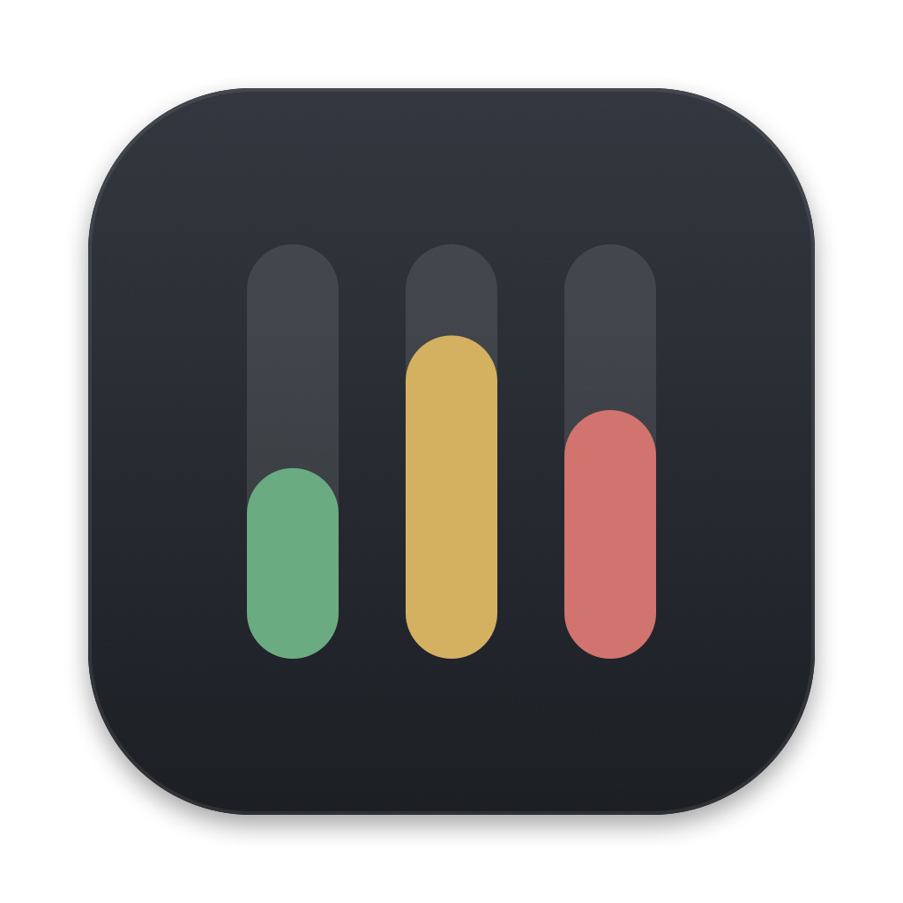

<p align="center">
  
</p>

<h1 align="center">Sysbar</h1>

<p align="center">
  <a href="https://github.com/Atanur/sysbar/releases"></a>
  <a href="https://github.com/Atanur/sysbar/releases/latest"></a>
  
  <a href="LICENSE"></a>
  <a href="https://github.com/Atanur/sysbar/stargazers"></a>
</p>

<p align="center">
  A tiny, native system monitor for the macOS menu bar.<br>
  <a href="https://sysbar.atanur.dev">sysbar.atanur.dev</a><br>
  CPU, GPU, memory, power, disk and network at a glance — and your servers over SSH when you need them.<br>
  <a href="CHANGELOG.md">What's new</a>
</p>

---

## Why Sysbar

- **Glanceable.** Each metric is a thin level bar and a fixed-width number, so the menu bar never shifts as values change. Bars can be tinted by load or follow the menu bar's own colour.
- **Light.** Written in Swift against the system's own counters. With the popover closed it uses about 2% of a single core and around 14 MB of memory, and it stops sampling while the Mac or its screens sleep.
- **Honest.** It shows what can be measured and hides what cannot. Values that are estimates are labelled as such.
- **Private.** No accounts, no analytics. Besides the SSH connections you set up, the only request is a once-a-day check for a new release on GitHub, which you can turn off; nothing about your Mac is sent.

## Features

**Menu bar**
- Choose any of CPU, GPU, memory, power, disk and network, and drag them into the order you like.
- Fixed-width slots: no jitter between `3%` and `100%`.
- Optional load colours (neutral → amber → red), adapted for light and dark menu bars.
- Three styles: bars and values, bars only (the smallest), or values only. The bars glide to a new level, and on start the logo's bars wave until the first reading arrives.
- On battery, the charge can join the menu bar once it drops to a level you choose (always, 80%, 50% or 20%), staying neutral until it turns amber and red.

**Popover**
- One card per metric with a graph of the last 150 samples, so its span follows the refresh rate (15 seconds at 0.1 s, 5 minutes at 2 s). Cards can be reordered and laid out automatically (two columns for an even count, one for an odd), in one column, or in two.
- The cards are black, white and grey. Colour appears only where it means something: a graph turns amber, orange and red as its load rises, and the charge going into the battery is green. On the adapter a bolt sits beside the percentage: green while it charges, plain once the battery is full or macOS holds the charge, and always plain on a Mac without a battery.
- Disk, Network and Power draw two lines either side of a zero line on one scale: read and write, download and upload, and what the Mac uses and what goes into the battery while it charges. The Disk card's corner shows the room left (amber under 15 %, red under 5 %), the Network card's shows Wi-Fi or Ethernet.
- Click a card to open the matching tab in Activity Monitor (or Battery settings). Right-click the menu bar item for Settings, Check for updates, About and Quit.
- Power reacts to how the Mac is powered: charge and time left on battery; on the adapter, the bolt in the corner and the adapter and wall draw in its tooltip.
- **Top apps** table with CPU, memory, GPU and estimated energy per app; helper processes fold into their app. CPU is a share of the whole Mac, like the CPU card, so the rows never add up to more than the total (one decimal under 10%). Columns are configurable.

**Temperature and fans**
- The fan button above the cards opens a panel that names what is warming the Mac: processor work, graphics work (language models, rendering, games), heavy work, cooling down, warm at rest, cooling at its limit, or macOS slowing down to cool. It shows CPU, GPU, memory and battery temperatures, each the mean of the hotter half of that part's sensors.
- A thermometer appears in the menu bar only when the heat is out of the ordinary; a busy chip in the 80s is not.
- The fan button is drawn still: an outline while macOS runs the fans, amber, orange and red as they work harder, dimmed when they stand still, and filled while you set them by hand.
- Fans: Automatic, or Manual with one slider from each fan's minimum to its maximum speed. Manual control uses a small helper that macOS asks you to approve once. It can only set fan speeds and keep the Mac awake (below), accepts only Sysbar signed by the same developer, and returns the fans to automatic when Sysbar quits, crashes or hangs (a 15-second lease), or when the Mac sleeps.

**Keep awake with the lid closed** (laptops)
- The laptop button next to the fan button keeps the Mac awake with its lid closed. A pop-up menu picks how long: 1 hour, 4 hours, until a time you set (today, or tomorrow if it has passed), until you turn it off, while the charger is connected, or for as long as an app you pick from the open ones stays open. It sets `pmset disablesleep` through the same helper, so there is no password prompt.
- It ends by itself when its time is up, when the charger is unplugged (for "while charging"), or when the battery falls to 20 % while unplugged, and the panel says why. It also ends when Sysbar quits, crashes or hangs (the same 15-second lease). If it is switched off elsewhere (`pmset disablesleep 0`), Sysbar notices within seconds.
- A setting you turned on yourself in Terminal is shown as on, and is only turned off if you choose Off.
- **Move the mouse when idle** keeps chat apps from showing "away": while keep awake is on and nobody has touched the Mac for a minute, the cursor takes a curved trip to the middle of the screen (or to the lower right, if it already is near the middle) and back, about once a minute. Nothing is clicked or typed, it waits while a button is held or the screen is locked or off, and it needs the Accessibility permission, which Sysbar asks for only when you turn this on. Using it to misrepresent your working hours, or against a workplace policy, is between you and your employer.
- A closed Mac in a bag can get warm; that is why it is never permanent.
- On a Mac without a lid (a Mac mini, Studio or iMac) the same menu keeps it from going to sleep while idle, with the same choices except "while charging". It needs no helper.

**Updates**
- Checks GitHub for a new release once a day and offers it in the popover, where **What's new** unfolds its notes. Updating downloads the release, installs it only if it is signed by the same developer, and relaunches.
- Settings › About shows what is new in the version you run, from the [changelog](CHANGELOG.md) built into the app; every release is on the website.

**Remote devices over SSH**
- Watch a Linux server or another Mac: CPU, memory, load average, network, disk and NVIDIA GPU where available, plus the busiest processes.
- Nothing to install on the server — a small read-only script is sent over `ssh` for each sample.
- Sampled while its tab is shown, and for a chosen time after the popover closes (off, 1 minute to 1 hour, or always; 5 minutes by default), so its graphs are still there when you come back. Switching to This Mac keeps the session going. The ssh connection is shared, so reopening does not log in again.
- Uses your existing ssh keys or ssh-agent. Passwords are never asked for or stored; unknown host keys are never accepted automatically.

**Settings**
- A full settings window: menu bar preview, which cards and columns to show, whether the fan and keep-awake buttons appear in the top bar, separate refresh rates for this Mac and for remote devices, launch at login.
- 13 languages: English, Türkçe, Deutsch, Français, Español, Italiano, Português (Brasil), Nederlands, Русский, 日本語, 한국어, 简体中文 and العربية. Follows the system language, or pick one in Settings.
- About links to the website, the source, release notes, and GitHub forms for problems and ideas that come with your version and Mac filled in. **Copy diagnostic info** adds the rest, without any device names or addresses.
- Reset all settings, keeping or removing remote devices.

## Requirements

- macOS 14 Sonoma or later
- Apple silicon (M1 or later)

## Install

With [Homebrew](https://brew.sh):

```bash
brew install --cask atanur/sysbar/sysbar
```

Or build it from source:

```bash
git clone https://github.com/atanur/sysbar.git
cd sysbar
./scripts/bundle.sh
open build/Sysbar.app
```

Move `build/Sysbar.app` to `/Applications` to keep it, and turn on **Launch at login** in Settings. Sysbar is not on the App Store: it reads power data through a private system interface that the App Store does not allow.

## Releasing

First write the release's notes in [CHANGELOG.md](CHANGELOG.md): a `## <version> — <date>` heading and a few `- ` items, written for people who use the app. `scripts/changelog.py draft <version>` lists the `feat`, `fix` and `perf` commits since the last tag to write them from. The same notes appear in the app's About page, on the GitHub release and on the website.

`scripts/release.sh <version>` refuses to run without those notes. It sets the version, builds and zips `Sysbar.app`, writes the Homebrew cask to `packaging/homebrew/Casks/sysbar.rb` with the zip's checksum, the release notes to `build/notes-<version>.md`, and the website's "What's new" into `docs/index.html`. It publishes nothing; it prints the remaining steps:

1. Commit the version bump and the website, tag it `v<version>` and push.
2. `gh release create v<version> build/Sysbar-<version>.zip --notes-file build/notes-<version>.md` to publish the GitHub release.
3. Copy the cask into the tap repository `atanur/homebrew-sysbar`, under `Casks/`, and push.
4. `npx wrangler deploy` to publish the website.

Set `SIGN_IDENTITY` (a Developer ID Application certificate) and `NOTARY_PROFILE` (from `xcrun notarytool store-credentials`) to sign and notarize the build. Without them it is ad-hoc signed and macOS blocks it on first launch, so a public release should be notarized.

## What can and cannot be measured

| Metric | Source |
|---|---|
| CPU, memory, disk, network | macOS kernel counters |
| GPU usage | the graphics driver's statistics |
| Total power | the System Management Controller |
| GPU and Neural Engine power | energy counters |
| Battery | the battery's registry entry |
| Per-app values | the kernel, for your own user's processes |

On current macOS, CPU and memory power counters cannot be read without root, so Sysbar does not show them rather than guess. Per-app energy is the system's own estimate and is lower than total power.

## Development

```bash
swift build                  # debug build
swift test                   # unit tests for the core library
./scripts/bundle.sh          # release app in build/Sysbar.app
./scripts/make-icon.sh       # redraw the icon from scripts/make-icon.swift
./scripts/strings.py extract # refresh the English source strings
./scripts/strings.py check   # verify every translation is complete
./scripts/changelog.py site  # refresh the website's "What's new" from CHANGELOG.md
```

`Sources/SysbarCore` holds the samplers, parsers and formatting, with no UI, and is what the tests cover. `Sources/Sysbar` is the AppKit and SwiftUI app. Every user-facing string goes through `L("English text")`; translations live in `Resources/Localization/<language>.lproj/Localizable.strings`.

Diagnostic flags, handy when checking a new Mac or server:

| Flag | What it does |
|---|---|
| `--probe` | prints every raw sensor reading once |
| `--remote-test HOST [USER [PORT [KEY]]]` | samples a server twice over ssh, exactly as the app does |
| `--remote-script` | prints the script sent to servers |
| `--smc-keys=PREFIX` | lists readable SMC keys, e.g. `Tp` for CPU temperatures |
| `--l10n-sample` | prints a few strings and numbers in the current language |
| `--open-popover` | opens the popover right after launch, for measuring its cost |
| `--popover-cycles N` | opens and closes the popover N times and prints the memory footprint after each close |
| `--settings-cycles N` | does the same with the settings window, showing every page |
| `--render-menubar PATH` | writes the menu bar readout, battery included, as a PNG in light and dark |
| `--fan-test` | sets the fans to manual 60 %, prints the SMC readings, then returns them to automatic |
| `--thermal-panel-test` | opens the popover, shows and hides the thermal panel, and prints the window's top edge and height |
| `--smc-raw=KEY,KEY` | prints SMC keys' types and raw bytes, read only |
| `--no-lid` | makes a laptop act like a Mac without a lid, to try its keep-awake menu |
| `--update-now` | checks for a release at once and installs it, as the Update button does |

## Website

[sysbar.atanur.dev](https://sysbar.atanur.dev) is the single page in `docs/`, served by Cloudflare. Its "What's new" section, between the `changelog:start` and `changelog:end` comments, is written by `scripts/changelog.py site`; edit CHANGELOG.md rather than the page. `wrangler.jsonc` deploys it as static assets on that custom domain:

```bash
npx wrangler deploy
```

## Contributing

Bug reports, translations and pull requests are welcome; [CONTRIBUTING.md](CONTRIBUTING.md) explains how to build, test and translate a change. Everyone taking part follows the [code of conduct](CODE_OF_CONDUCT.md). Please report security problems privately, as described in the [security policy](.github/SECURITY.md), and accessibility barriers as described in [ACCESSIBILITY.md](ACCESSIBILITY.md).

## License

[MIT](LICENSE)
